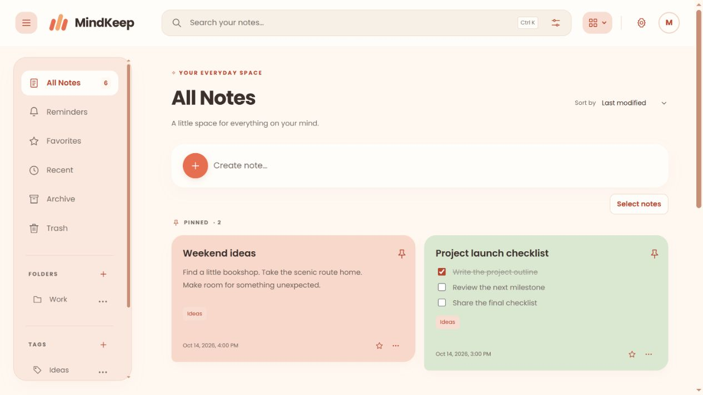
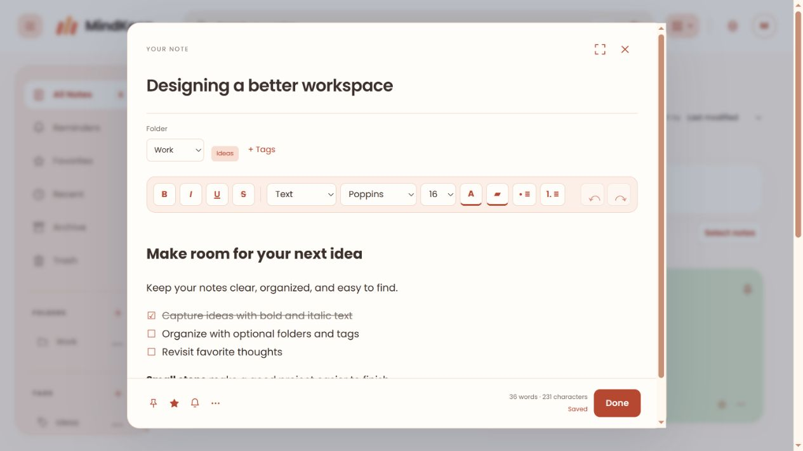
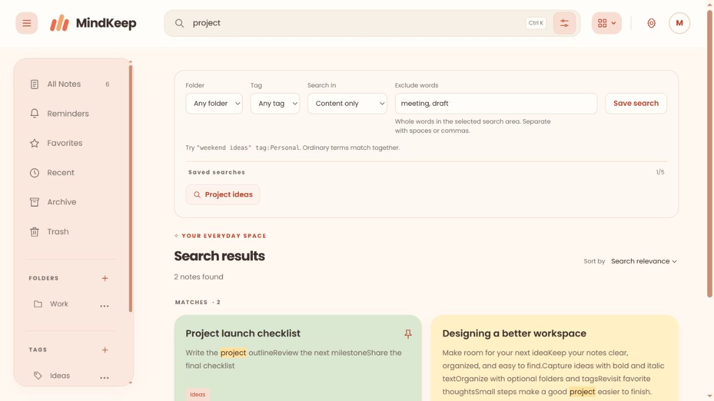

# MindKeep

MindKeep is a personal notes app for capturing ideas, everyday plans, and things you want to remember. It brings writing, organization, and fast search together in a calm peach workspace, with light and dark modes.

## Features

- Rich-text notes with bold, italic, checklists, and image or audio attachments.
- Optional folders and tags, favorites, reminders, and your five most recently visited notes.
- A custom C++ search engine with phrase search, prefix matching, filters, and highlighted results.
- Automatic saving, encrypted local drafts, and synchronization when connected.
- Read-only sharing, note exports, and library backup and restore.

## Screenshots

Current interface captured with demonstration notes.

### Home

A colorful workspace with quick capture and flexible note layouts.

### Rich-text editor

Shape an idea with formatting, checklists, and optional organization.

### Search

Find notes with highlighted matches, content-only search, exclusions, and reusable saved searches.

## Built with

C++20, MySQL, HTML, CSS, and JavaScript. The frontend runs without a build step.

For local installation and configuration, see [Setup](docs/setup.md).
